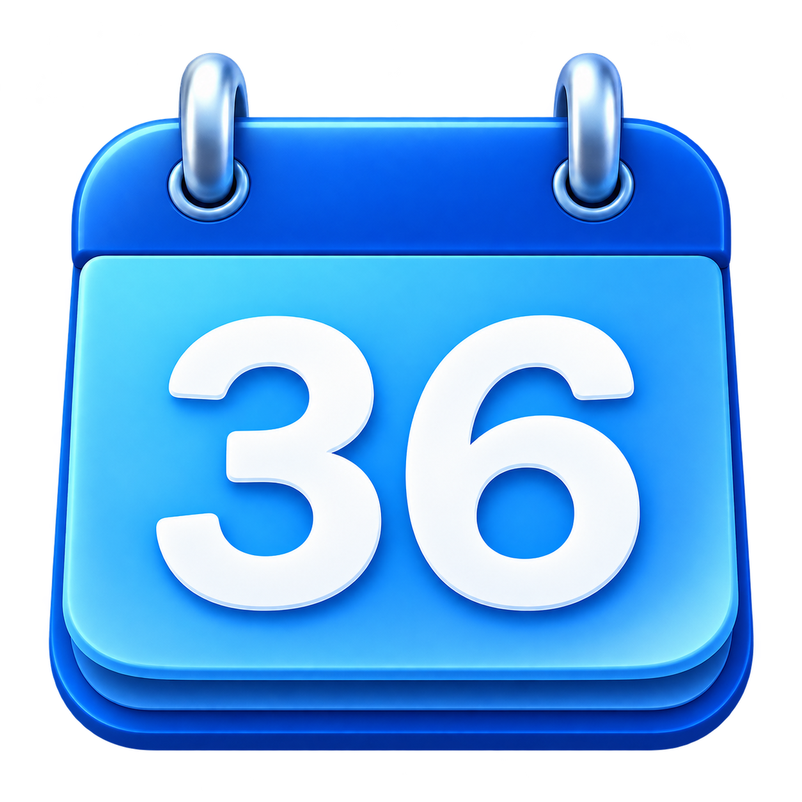

<div align="center">
  

  # 📅 Calendar Deck

  ### **Lịch tuần. Lịch tháng. Lịch năm. Ngay trên desktop.**

  Ứng dụng lịch Windows siêu nhẹ, siêu nhanh — viết bằng C++20 & Direct2D thuần.
  Đồng bộ Google Calendar, nhập file ICS offline, xem mọi thứ trong một nháy mắt.

  [English](README.md) · **Tiếng Việt**

  
  
  
  

  ---

  > 🚀 **Đại Cập Nhật Giao Diện** — Thiết kế lại hoàn toàn với layout thẻ hiện đại, nút chuyển view dạng viên thuốc, và giao diện tối cực đẹp. Ba chế độ xem, năm màu sự kiện, và thanh trạng thái dock phía dưới. Đây không phải app lịch xưa cũ nữa đâu.

</div>

---

## ✨ Có gì mới trong v0.2.4?

| 🎯 Tính năng | Mô tả |
|---|---|
| 🖼️ **Giao diện hoàn toàn mới** | Theme tối hiện đại, thẻ bo cong, nút view dạng pill, hiệu ứng hover, render mượt bằng Direct2D |
| 📆 **3 Chế độ xem** | Chuyển mượt mà giữa **Tuần**, **Tháng** và **Năm** bằng `Ctrl+1/2/3` |
| 🎨 **5 Màu sự kiện** | Xanh biển · Tím · Xanh lá · Hồng · Vàng — mỗi màu có nền thẻ và viền riêng |
| 🔄 **Đồng bộ thông minh** | Tự động kiểm tra Google Calendar (5 phút – 24 giờ), cache offline, request có điều kiện |
| 📁 **Nhập ICS offline** | Nhập file `.ics` một cú click. Thay file mới khi lịch đổi — giữ nguyên cài đặt |
| 🖥️ **Widget Desktop** | Gắn lịch sau tất cả cửa sổ. Khóa vị trí, thoải mái thay đổi kích thước |
| 🌐 **Song ngữ Việt – Anh** | Hỗ trợ đầy đủ Tiếng Việt 🇻🇳 và English 🇬🇧 — đổi trong Cài đặt |
| ⚡ **~48 MB bộ nhớ** | Win32 thuần. Không Electron. Không trình duyệt nhúng. Không runtime. Chỉ có hiệu năng |

---

## 🖥️ Ba Chế Độ Xem

### 📋 Lịch Tuần
> Trung tâm điều khiển của bạn. Dải giờ đầy đủ **00:00–24:00**, 7 ngày Thứ Hai đến Chủ Nhật.

- **Thẻ sự kiện bo cong** với thanh màu bên trái
- **Vạch giờ hiện tại** — đường đỏ với badge giờ, di chuyển real-time
- **Đánh dấu hôm nay** — cột nền xanh dịu nhẹ
- **Dải sự kiện cả ngày** — chip gọn phía trên lưới
- **Cột trùng giờ** — nhiều sự kiện cùng lúc hiển thị song song
- **Hiệu ứng hover** — thẻ phát sáng khi rê chuột qua

### 📊 Lịch Tháng
> Toàn cảnh một tháng. Lưới 6 tuần với chip sự kiện cho từng ngày.

- **Chip sự kiện hằng ngày** với chấm màu và nhãn giờ
- **Badge tràn** — hiện `+N sự kiện` khi ngày nào quá nhiều lịch
- **Click bất kỳ ngày nào** để nhảy thẳng đến tuần đó
- **Badge hôm nay** — vòng tròn xanh nổi bật
- **Ngày ngoài tháng** hiện mờ nhạt cho dễ hình dung

### 🗓️ Lịch Năm
> 12 thẻ tháng mini trên cùng một màn hình. Phát hiện ngay những khoảng bận rộn.

- **Badge đếm sự kiện** trên từng thẻ tháng
- **Chấm đánh dấu** trên ngày có lịch
- **Click tháng bất kỳ** để nhảy sang Lịch Tháng
- **Hover card** phát sáng viền xanh

---

## 🚀 Bắt Đầu Nhanh

### 1. Tải về và chạy

Giải nén `CalendarDeck-v0.2.4-windows-x64.zip` → mở **CalendarDeck.exe**. Xong!

> [!NOTE]
> Không cần cài đặt, không cần quyền admin, không phụ thuộc gì cả. Chạy trên **Windows 10 (1903+)** hoặc **Windows 11**, bản x64.

### 2. Thêm lịch của bạn

Mở **Cài đặt (Settings) → Calendars**, rồi chọn cách thêm:

| 🌐 Thêm bằng URL | 📁 Nhập file .ics |
|---|---|
| Dán link iCal từ Google Calendar | Chọn file `.ics` trên máy |
| Tự kiểm tra cập nhật theo chu kỳ | Lưu bản lịch offline ngay lập tức |
| Vẫn xem cache khi mất mạng | Không cần đăng nhập Google |
| Hỗ trợ feed công khai & bí mật | Bấm **Replace .ics** khi lịch đổi |

### 3. Tạo biểu tượng trên Desktop

```powershell
.\create-desktop-shortcut.ps1
```

Icon lịch xanh số **36** đã nhúng vào EXE — không cần file icon ngoài.

---

## 🔗 Kết Nối Google Calendar

1. Mở [Google Calendar](https://calendar.google.com) trên máy tính
2. **Cài đặt → chọn lịch → Tích hợp lịch**
3. Sao chép **Địa chỉ bí mật ở định dạng iCal** (hoặc Địa chỉ công khai)
4. Trong Calendar Deck: **Add URL Calendar** → dán URL → đặt tên & chọn màu → **Save**

> [!IMPORTANT]
> **Giữ kín URL bí mật như mật khẩu.** Không đưa vào ảnh chụp, issue, hay repo công khai.

### Cơ chế đồng bộ

| Thao tác | Ý nghĩa |
|---|---|
| **Sync now** | Kiểm tra lịch URL đang chọn |
| Nút **Đồng bộ** / `F5` | Kiểm tra tất cả nguồn URL |
| **Chu kỳ tự động** | Mặc định **15 phút** (tùy chỉnh: 5–1440 phút) |
| **Cache offline** | Bản cache hợp lệ vẫn hiện khi đồng bộ thất bại |

> [!NOTE]
> Google có thể chậm cập nhật feed iCal. Calendar Deck chỉ đọc một chiều — không sửa đổi Google Calendar của bạn.

---

## 📁 Nhập File ICS

1. Chuẩn bị file `.ics` (từ Google Export, thời khóa biểu trường, v.v.)
2. **Settings → Calendars → Import .ics...**
3. App nhập và lưu ngay, đánh dấu **(file)** trong danh sách
4. Tùy chỉnh tên, màu, hiển thị → **Save calendar**
5. Click sự kiện để xem đầy đủ: tên, giờ, địa điểm, mô tả, nguồn lịch

### Khi lịch thay đổi

Chọn lịch đã nhập → **Replace .ics...** → chọn file mới.
Sự kiện cập nhật ngay. **Tên, màu, trạng thái hiển thị được giữ nguyên.**

> [!TIP]
> Luôn dùng **Replace** thay vì nhập lịch mới để tránh trùng lặp.

### Định dạng hỗ trợ
- File `.ics` mã hóa UTF-8 (bao gồm UTF-8 BOM)
- Tối đa **10 MiB** mỗi file
- File ZIP cần giải nén trước

---

## ⌨️ Phím Tắt

| Thao tác | Phím tắt |
|---|---|
| Lịch Tuần | `Ctrl+1` |
| Lịch Tháng | `Ctrl+2` |
| Lịch Năm | `Ctrl+3` |
| Tuần / tháng trước / sau | `←` / `→` |
| Về hôm nay | `Home` |
| Mở Cài đặt | `Ctrl+S` |
| Đồng bộ tất cả | `F5` |
| Ẩn widget | `Esc` |

---

## 🖥️ Chế Độ Desktop & Floating

| Chế độ | Hoạt động |
|---|---|
| **Floating** | Cửa sổ bình thường, có taskbar, thu nhỏ/phóng to, kéo & thay đổi kích thước |
| **Desktop** | Gắn sau tất cả cửa sổ, nằm trên desktop. Kéo header/cạnh khi mở khóa |

> Chuột phải trên lịch hoặc icon khay để chuyển chế độ hoặc bật/tắt **Khóa vị trí widget**.

### Đóng, Ẩn & Thoát

Trong **Settings → General**, chọn nút Close sẽ:
- **Ẩn xuống khay hệ thống** (mặc định) — nhấp đúp icon khay để hiện lại
- **Thoát hoàn toàn** — dùng **Exit** ở menu khay để dừng hẳn

---

## 💾 Dữ Liệu & Lưu Trữ

| Chế độ | Vị trí database |
|---|---|
| Bình thường | `%LOCALAPPDATA%\CalendarDeck\calendar-deck.db` |
| Portable (`--portable`) | `data\calendar-deck.db` cạnh EXE |

- Tất cả dữ liệu mã hóa bằng **Windows DPAPI** trước khi lưu SQLite
- Dữ liệu portable vẫn gắn với tài khoản Windows hiện tại
- Giữ file ICS gốc hoặc URL nguồn nếu cần chuyển tài khoản/máy

### Nâng cấp phiên bản

1. **Exit** từ khay hệ thống
2. Thay file ứng dụng mới
3. Mở lại — dữ liệu vẫn còn trong AppData (hoặc `data/` cho portable)

### Chế độ Demo

```powershell
.\CalendarDeck.exe --portable --demo
```

> Nên dùng thư mục riêng cho demo. Mỗi thư mục dữ liệu chỉ chạy một instance.

---

## 🔧 Xử Lý Sự Cố

| Hiện tượng | Cách xử lý |
|---|---|
| Lịch hiện "Busy" hoặc thiếu tên | Kiểm tra quyền nguồn — feed rảnh/bận không chứa chi tiết |
| Public feed không truy cập được | Kiểm tra quyền xem không cần đăng nhập; chính sách xuất iCal |
| Không có Secret address | Tài khoản trường/cơ quan bị hạn chế — thử xuất ICS đầy đủ |
| Không có sự kiện sau khi nhập | Kiểm tra tuần đang xem, trạng thái hiển thị, và khoảng ngày trong file |
| Sự kiện bị trùng | Dùng **Replace .ics** thay vì nhập lại |
| Giờ bị sai | Kiểm tra múi giờ Windows; dùng bản 0.2.3+ |
| Đóng mà app vẫn chạy | Tắt close-to-tray, hoặc chọn **Exit** ở khay |
| Desktop mode không hoạt động | Explorer/WorkerW hoặc app wallpaper có thể ảnh hưởng — dùng Floating |

---

## 🏗️ Build Từ Mã Nguồn

**Yêu cầu:** CMake 3.24+ và MinGW-w64 GCC + Ninja, hoặc Visual Studio 2022 C++ tools.

```powershell
.\scripts\build.ps1
```

Hoặc chạy thủ công:

```powershell
cmake -S . -B build/release -G Ninja -DCMAKE_BUILD_TYPE=Release
cmake --build build/release
ctest --test-dir build/release --output-on-failure
```

### Đóng gói để chia sẻ

```powershell
.\scripts\package.ps1
```

| Kết quả | Mục đích |
|---|---|
| `dist/CalendarDeck/` | App chạy được + hướng dẫn |
| `dist/CalendarDeck-v0.2.4-windows-x64.zip` | Gói nhị phân cho Releases |
| `dist/CalendarDeck-v0.2.4-source.zip` | Mã nguồn chọn lọc |
| `dist/SHA256SUMS.txt` | Mã kiểm tra SHA-256 |

---

## 📂 Cấu Trúc Dự Án

```
CalendarDeck/
├── src/           # Nhân app — UI, engine lịch, lưu trữ
├── resources/     # Icon (9 kích thước), manifest, thông tin phiên bản
├── scripts/       # Build, đóng gói & tự động tạo shortcut
├── tests/         # 96 kiểm thử bằng dữ liệu tổng hợp
├── docs/          # Kiến trúc & kết quả kiểm chứng
├── build/         # File sinh tự động (git-ignored)
└── dist/          # Gói phân phối (git-ignored)
```

## 🔬 Hiệu Năng & Kiểm Chứng

- **Event-driven** message loop Win32 — không render liên tục 60 FPS
- **~48–49 MiB** working set (đo trên demo ngắn)
- **96 kiểm thử core** pass trên CTest
- Lịch lặp đã đối chiếu với **5 file Google × 104 tuần** (487 bản ghi khớp)
- Hỗ trợ: DAILY/WEEKLY/MONTHLY/YEARLY, INTERVAL, COUNT, UNTIL, WKST, BYDAY, BYMONTHDAY, BYMONTH, BYSETPOS, EXDATE, RDATE, ngoại lệ RECURRENCE-ID

---

## 📚 Đóng Góp & Tài Liệu

Xem [CONTRIBUTING.md](CONTRIBUTING.md) và [Ghi chú kiến trúc](docs/ARCHITECTURE.md).

**Tham khảo:**
[Google iCal Sync](https://support.google.com/calendar/answer/37648) ·
[Xuất lịch Google](https://support.google.com/calendar/answer/37111) ·
[Lịch công khai](https://support.google.com/calendar/answer/37083) ·
[RFC 5545](https://www.rfc-editor.org/rfc/rfc5545)

---

<div align="center">
  <sub>Được xây dựng với ❤️ bằng C++20 · Win32 · Direct2D · DirectWrite</sub>
  <br>
  <sub>Không Electron. Không phình to. Chỉ có lịch của bạn.</sub>
</div>
